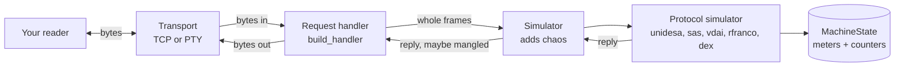

# Architecture

Small on purpose. Five layers, each one dumb in its own specific way, which is why the whole thing works.

## The pipeline



| Layer              | Lives in                     | Knows about                    | Doesn't know about        |
|--------------------|------------------------------|--------------------------------|---------------------------|
| Transport          | `core/transport.py`          | sockets, PTYs, threads         | protocols, chaos          |
| Request handler    | `core/simulator.py`          | Unidesa framing, error handling | sockets, PTYs            |
| Simulator          | `core/simulator.py`          | chaos                          | which protocol it's running |
| Protocol simulator | `protocols/*.py`             | its own wire format, the state | transports, chaos         |
| State              | `models/state.py`            | numbers                        | everything else, happily  |

The CLI (`cli/main.py`) and the pytest fixture (`pytest_plugin.py`) both assemble the same pipeline. The
factory in `core/factory.py` turns a protocol name into a configured protocol simulator.

## One contract

Every protocol simulator has a `name`, a `state`, and this:

```python
def handle(self, data: bytes) -> bytes: ...
```

Bytes in, bytes out. An empty reply means "say nothing". Empty input means "the line is idle, speak now if you
have something to say". Almost nobody does.

That's the whole interface. A protocol can be tested by calling `handle()` in a unit test, no sockets, no
threads. It can be run over TCP or a PTY without changing a line. And chaos can be bolted on without the
protocol ever finding out.

## Who buffers what

Transports don't frame anything. A single read can hold half a message or three of them, and somebody has to
sort it out:

| Protocol        | Who reassembles partial input                          |
|-----------------|--------------------------------------------------------|
| Unidesa / Cirsa | The request handler, with `split_unidesa_frames`       |
| SAS             | Nobody. One request per read, the way SAS hosts behave. |
| VDAI            | The protocol, until a line feed                        |
| RFranco         | The protocol, until CR or LF                           |
| DEX             | The protocol, per state of its state machine           |

## Threads

- **TCP**: `start()` accepts clients in a loop and gives each one its own daemon thread. `stop()` closes the
  listening socket, which knocks `accept()` out of its chair.
- **PTY**: one loop, one thread. It waits up to 100 ms for input. If nothing shows up, it calls the handler
  with empty input (the idle tick), so a protocol can talk unprompted. Only SAS does.
- **Both** set a `ready` event once they're actually usable. The pytest fixture waits on it, so a test never
  connects to a server that isn't there yet.
- `start()` blocks. The CLI runs it on the main thread until Ctrl+C. The fixture runs it on a daemon thread.

## Errors

The request handler catches anything a protocol raises, logs it with the traceback, and returns an empty reply.
The reader sees silence, same as with real hardware that didn't like what it heard. The server keeps going.

Called directly, the protocols are stricter. `UnidesaSimulator.handle()` raises `ValueError` on a bad frame, so
unit tests can check the error.

## Design calls worth knowing

- **The reader wins.** The simulators are built to satisfy the reader scripts, byte for byte. When the reader
  and the spec disagree, the simulator matches the reader and a comment says why. The reader is what has to
  work on Monday.
- **Nothing electrical.** No 9-bit serial, no baud rates, no RS-485 timing. Sizes, offsets, checksums and
  flow are real. Voltages are somebody else's problem.
- **State is shared, not copied.** The simulator holds a reference to the `MachineState` you gave it. Change a
  meter mid-test and the next reply has it.
- **Machines don't move their own meters.** Except SAS AFT, which moves `credits`, because that's the whole
  point of AFT.

## Module map

```text
src/morpheus_vlt/
  __init__.py           exports Simulator
  cli/main.py           the morpheus-vlt command
  core/
    chaos.py            ChaosProfile: drop, corrupt, flip, delay, duplicate
    factory.py          build_protocol(): name -> protocol simulator
    framing.py          Unidesa frames: XOR55, parse, build, split
    simulator.py        Simulator and build_handler()
    transport.py        TCPByteServer, PtyByteServer
  models/state.py       MachineState
  protocols/
    dex.py              DEX/UCS, the VMC side
    rfranco.py          RFranco ASCII
    sas.py              SAS, shape of the bytes
    unidesa.py          Unidesa/Cirsa counters
    vdai.py             VDAI printouts
  pytest_plugin.py      the morpheus_vlt_server fixture
```
