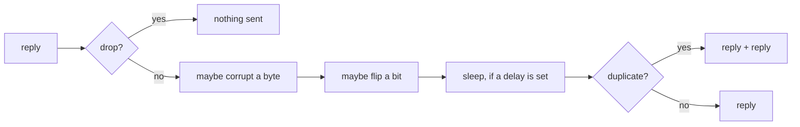

# Chaos testing

Real serial lines drop bytes, double up, flip bits and take their sweet time. Real TCP links do too, they're
just more polite about it. Your reader has to survive all of that, and the only way to find out is to do it
to it on purpose, before production does it for free.

Because chaos is love.

## The knobs

| Knob | What happens to a reply | What it simulates |
| --- | --- | --- |
| `drop_rate` | It never gets sent. | Timeouts, dead lines, unplugged cables |
| `corrupt_rate` | One random byte gets a random non-zero value added to it. | Checksum and CRC failures |
| `flip_bit_rate` | One random bit of one random byte gets flipped. | Line noise, the classic |
| `delay_ms_min/max` | Sleeps a random time in that range before sending. | Slow machines, busy links, 9600 baud |
| `duplicate_rate` | The reply goes out twice, back to back. | Retransmits, confused converters |

Each rate is a probability from 0 to 1. `0.1` means one reply in ten, on average. On average. Randomness
doesn't owe you anything.

A corrupted byte is guaranteed to change. The added value is between 1 and 254, so it never adds up to the
same byte.

## Turning it on

```bash
# 10% timeouts, 5% corrupted replies, 50 to 250 ms of added latency
morpheus-vlt --protocol unidesa --chaos \
  --drop-rate 0.10 --corrupt-rate 0.05 \
  --delay-ms-min 50 --delay-ms-max 250
```

!!! warning "No `--chaos`, no chaos"
    The rates do nothing unless `--chaos` is on. That one will get you at least once. It got me.

From Python, build a `ChaosProfile` and hand it to the [pytest fixture](pytest.md) or a `Simulator`:

```python
from morpheus_vlt.core.chaos import ChaosProfile

chaos = ChaosProfile(enabled=True, drop_rate=0.1, corrupt_rate=0.05, seed=42)

def test_reader_survives_a_bad_line(morpheus_vlt_server):
    sim = morpheus_vlt_server(protocol="sas", transport="pty", chaos=chaos)
    ...
```

## Order of operations

Every reply goes through the same steps, in this order:



Consequences worth knowing:

- A duplicate is a copy of the **already mangled** reply. If it's wrong, it's consistently wrong.
- Duplicates go out glued together in one write. That's exactly how they'd look on the wire anyway.
- A reply can be both corrupted and bit-flipped. Bad days come in bunches.
- The delay sleeps inside the server. On TCP that holds up that one client. On a PTY it holds up the whole
  line, same as a real slow machine.

## Same disaster, every run

Random failures are great for finding bugs and terrible for fixing them. Pin the randomness:

```bash
MORPHEUS_VLT_CHAOS_SEED=42 morpheus-vlt --protocol sas --chaos --drop-rate 0.2
```

Or pass `seed=42` to `ChaosProfile`. Same seed, same sequence of drops and flips, as long as the requests
come in the same order.

!!! note "It's the global `random`"
    The seed goes into Python's global `random` module. Anything else in the same process that uses `random`
    becomes reproducible too, whether it asked to or not. In a test suite that's usually fine. Usually.

## Fine print

- Chaos only touches **replies**. Requests reach the protocol untouched.
- On a PTY, the idle tick (empty input every 100 ms) runs through chaos too. A reply that's empty can't be
  corrupted, flipped or duplicated, but the delay still applies. Yes, it can delay nothing. Set a long delay on
  a PTY and the whole line gets sluggish, which, to be fair, is realistic.
- Chaos is applied per frame for Unidesa/Cirsa (each frame in a burst rolls its own dice) and per chunk of
  input for everybody else.

## Recipes

```bash
# The cable is half unplugged
morpheus-vlt --protocol sas --chaos --drop-rate 0.3

# Cheap USB-serial adapter in a room full of motors
morpheus-vlt --protocol sas --chaos --flip-bit-rate 0.05 --corrupt-rate 0.02

# Machine from 1998 on a Monday
morpheus-vlt --protocol vdai --chaos --delay-ms-min 500 --delay-ms-max 1800

# Everything at once, for the brave
morpheus-vlt --protocol unidesa --chaos --drop-rate 0.05 --duplicate-rate 0.05 \
  --corrupt-rate 0.05 --flip-bit-rate 0.05 --delay-ms-min 10 --delay-ms-max 300
```

What "survives" means is up to your reader. At minimum: no crash, no garbage written to the database, and a
retry that eventually gets a clean read.
