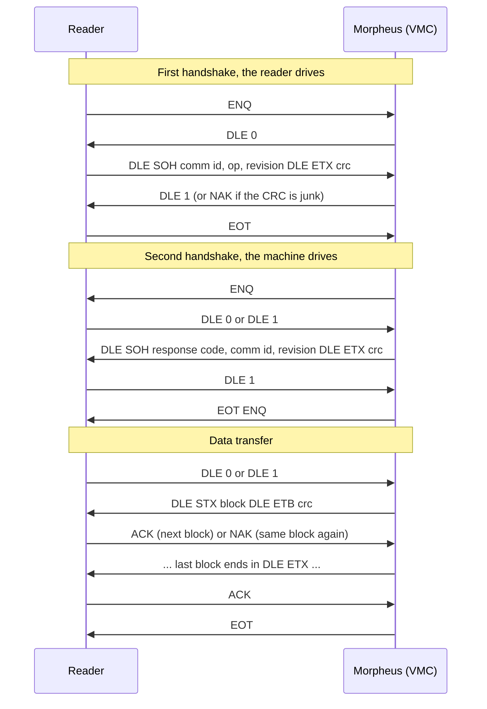

# DEX / UCS

DEX is how vending machines hand over their audit data: two handshakes, then an EVA-DTS text file sent in
DLE-framed blocks with a CRC-16 on each one. It's a protocol from the days when a handheld terminal was
cutting-edge, and it has been feeling its age ever since.

The simulator plays the machine (the VMC). Your reader plays the data carrier.

## The dance



After the final EOT the session resets and the simulator waits for the next reader's ENQ.

ACKs alternate between `DLE 0` and `DLE 1`. The simulator is relaxed about which one it gets, except right
after the second handshake, where only `DLE 1` counts.

## Control bytes

| Name    | Bytes      | Name    | Bytes      |
|---------|------------|---------|------------|
| ENQ     | `05`       | DLE SOH | `10 01`    |
| EOT     | `04`       | DLE STX | `10 02`    |
| NAK     | `15`       | DLE ETX | `10 03`    |
| DLE 0   | `10 30`    | DLE ETB | `10 17`    |
| DLE 1   | `10 31`    |         |            |

## Handshakes

**First handshake request** (from the reader):

```text
DLE SOH  comm_id(10)  op(1)  revision(6)  DLE ETX  crc_lo crc_hi
```

The simulator checks the CRC, answers `DLE 1` if it's good and `NAK` if it isn't, and remembers the reader's
comm id and revision for the second handshake. A request too short to hold both falls back to the simulator's
own values.

**Second handshake** (from the machine):

```text
DLE SOH  response_code(2)  comm_id(10)  revision(6)  DLE ETX  crc_lo crc_hi
```

The comm id and revision are the reader's own, echoed right back. The response code is the simulator's.

| Field         | Size | Default      | Flag                  | Padding when too short       |
|---------------|------|--------------|-----------------------|------------------------------|
| Comm id       | 10   | `0000000001` | `--dex-comm-id`       | zeros on the left            |
| Revision      | 6    | `R01L01`     | `--dex-rev`           | spaces on the right          |
| Response code | 2    | `00`         | `--dex-response-code` | zeros on the left            |

Too long gets chopped. DEX doesn't negotiate.

## Data blocks

```text
DLE STX  data  DLE ETB  crc_lo crc_hi     (every block but the last)
DLE STX  data  DLE ETX  crc_lo crc_hi     (the last block)
```

- One block per EVA-DTS line. Lines longer than 243 bytes get split across blocks, because a block tops out at
  245 bytes and the closing `DLE ETB/ETX` counts against it.
- A `DLE` inside the data gets doubled so it isn't mistaken for framing.
- `NAK` gets the same block again. No attitude.

## CRC

CRC-16 with polynomial x16 + x15 + x2 + 1, initial value 0, low byte first. That's the one usually called
CRC-16/ARC: the check value for `"123456789"` is `0xBB3D`. It covers the payload plus the closing ETX or ETB,
and skips DLE and SYN bytes.

It skips every `0x10`, including one that's actual data and not framing. EVA-DTS files are printable ASCII,
so that hasn't mattered yet. If it ever does, `dex_crc16_bytes` is where to start looking.

## The EVA-DTS file

Pass one with `--dex-file`. Lines get CRLF endings whatever the file had. Bytes that aren't valid UTF-8 or
ASCII go out as `?` instead of crashing anything.

No file? You get the smallest one that still looks legit:

```text
DXS*0000000001*VA*V0/6*1
ST*001*0001
ID1*0000000001*Simulated*0001*Machine Name**0*6*2
VA1*0*0*0*0
SE*4*0001
DXE*1*1
```

Header, machine id, zero vends, trailer. The comm id inside follows `--dex-comm-id`. The `SE` segment count is
computed, because hardcoded counts are how you get 3 AM phone calls.

DEX doesn't read `MachineState` at all. Want different numbers in the audit? Write a different file.

## Slow lines

Bytes can arrive in any size chunks, down to one at a time, and the simulator waits for the rest of whatever
it's expecting. Junk between messages gets thrown away. A `DLE SOH` that never gets its `DLE ETX` is dropped
after 256 bytes, and the simulator resyncs on the next one.
